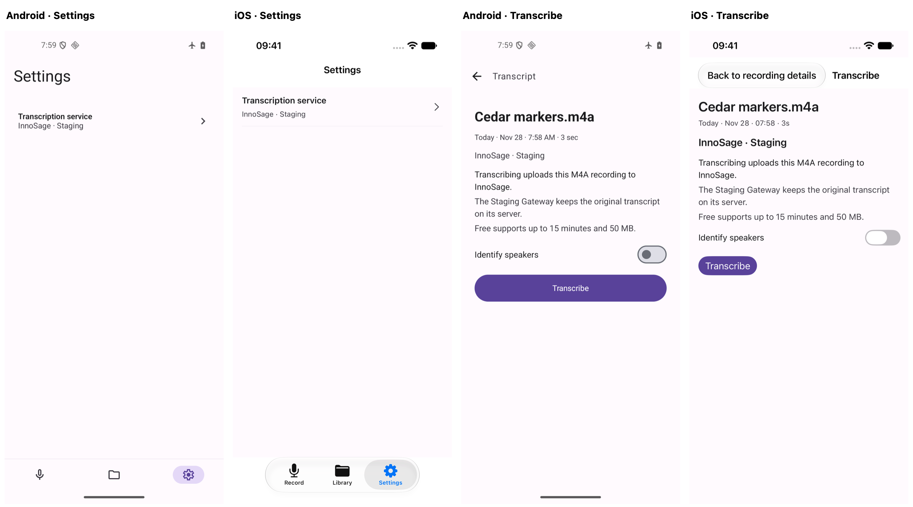

# Recorder 0.1.9 (16) engineering evidence

[Draft #140](https://github.com/innosage-llc/innosage-labs/pull/140) at `62a2b0e09b47222329260cfba7d38610f02f67c5` includes #141. The [candidate receipt](candidate.json) binds its signed bundle and local integration. This evidence commit contains screenshots and receipts separately from the product PR.

Both Release apps opened the same synthetic M4A through the system picker. iOS shared the original recording to a separate Files destination. Android performed offline play, seek and cold reopen, then shared the exact bytes to a receiving app. Both recipients matched the synthetic source SHA-256 `8a295edf4add565869f510cb0de211bec2005d531ff7a4fb86cca7f8c36a9d16`. [iOS system Files](ios/files.json) · [Android receipt](android/verification.json).

The live Staging test ran once on the preceding Release candidate `61f58840ac6b27987ce2fb913525dff27ed41728`; its synthetic audio was seeded in a dedicated simulator. Both spoken markers appeared in the returned saved transcript. The shipping candidate reopened the same recording identity, original and distinct edit after the simulator guest credentials had been removed. The iOS run proves local cold reopen without saved guest access. Per-simulator network isolation and physical iPhone capture remain unverified. [Live outcome](staging-61f5884/verification-live.json) · [Shipping candidate reopen](ios/reuse.json).

The signed archive contains only the approved Staging Free build input and keeps iOS Production Free ineligible. Dependency and native configuration comparison supported the previously owner-confirmed exempt declaration, `ITSAppUsesNonExemptEncryption=false`, verified inside the signed application.

[Four original flow pairs and retention proof from build 15](https://github.com/innosage-llc/innosage-labs/tree/f10d8bbff67a94ac636613675fec73b8f243abc0/docs/evidence/labs-139). [Separate browser and saved Markdown follow-up](https://github.com/innosage-llc/innosage-labs/pull/145).
