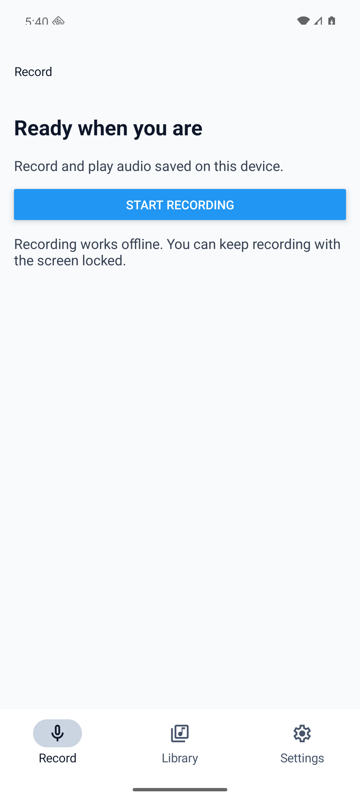
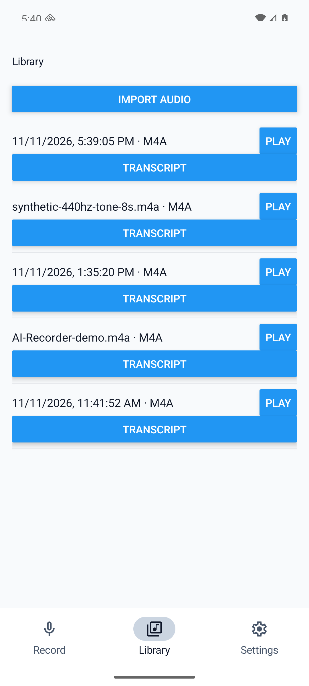
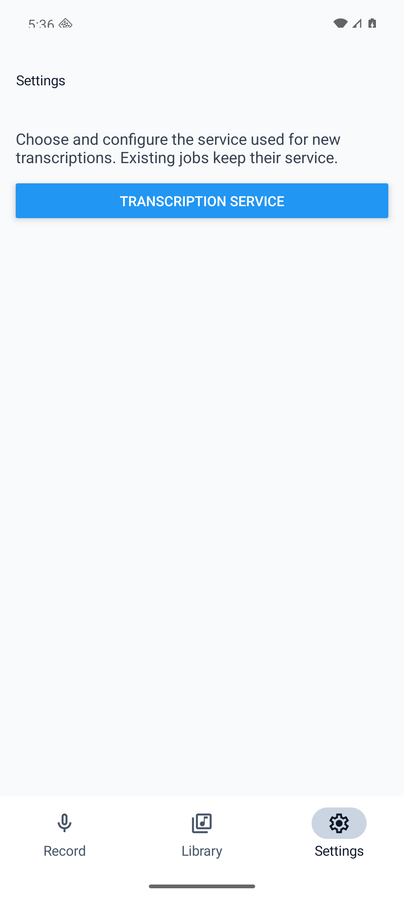
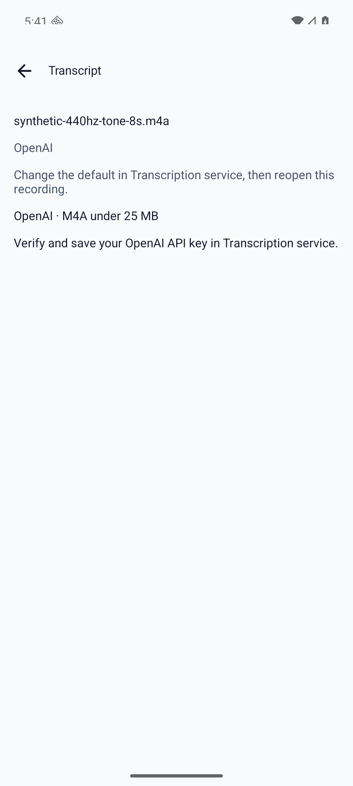
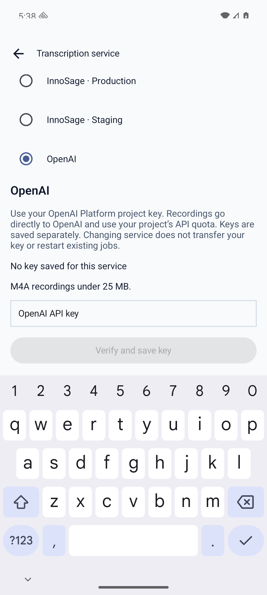
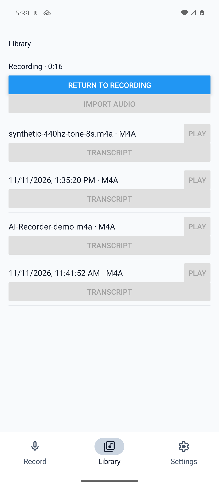
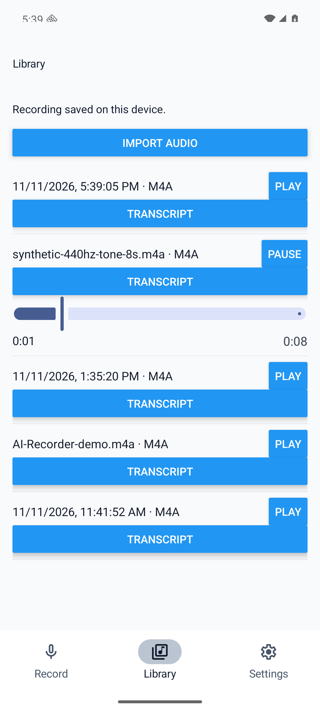
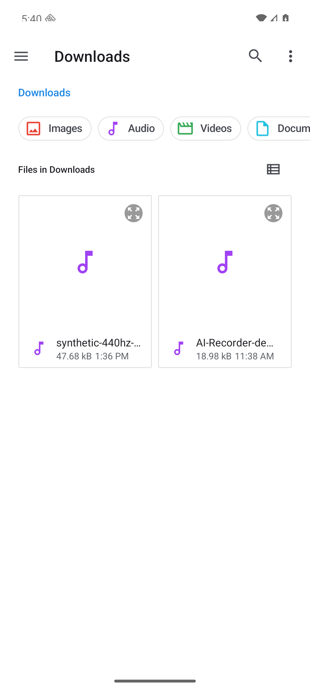
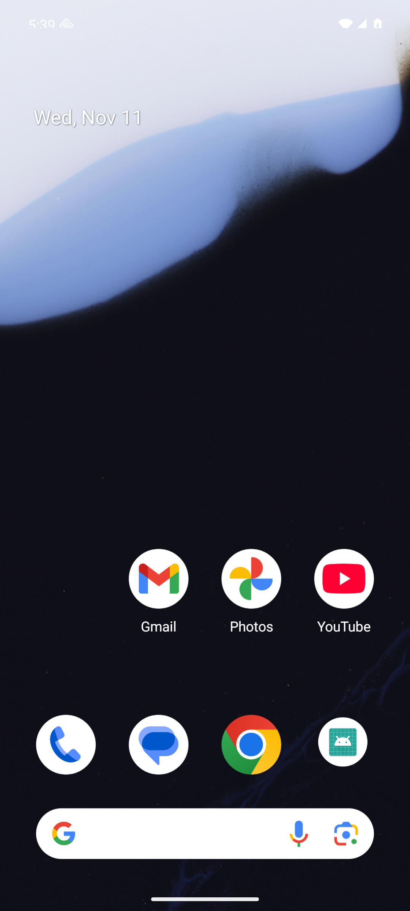

# Verification

## Automated checks

- `npm run typecheck`: PASS.
- `npm run test:transcript`: PASS, 18/18 existing protocol tests.
- `npm run test:navigation`: PASS, 4/4 root/transition/exit/edit-lock tests.
- `./gradlew :app:assembleRelease --offline`: PASS on final source, 8 seconds,
  360 actionable tasks (23 executed, 337 up-to-date). Node 24, JDK 17, SDK 36.
- Final APK: `examples/ai-recorder/android/app/build/outputs/apk/release/app-release.apk`.
  Local release variant uses the project's existing debug signing configuration;
  this is an emulator validation artifact, not a store-distribution release.
- `adb install -r` to clean API 36 emulator: PASS. Existing test data retained.
- Exact source and APK SHA256 values are in `source-hashes.json`.

## Native journey evidence

1. Record root: PASS. Native top title, bottom roots, single capture primary action.
   
2. Library root: PASS. Existing recordings, import action, native selected state,
   virtualized list. XML native parent exposes `selected=true` for Library.
   
3. Settings root: PASS. Existing transcription configuration destination.
   
4. Transcript detail: PASS for safe unconfigured OpenAI state. Fixed top Back and
   recording identity; top Back and Android system Back return to Library.
   
5. Service/keyboard: PASS. Focused empty key field only; no key entered or verified.
   Keyboard initially covered the action. Added KeyboardAvoidingView; scroll now
   exposes the action above keyboard while header remains fixed. System Back first
   dismisses keyboard, then detail returns to Settings; root Back returns Record.
   
6. Recording continuity: PASS. Started local emulator test capture, switched to
   Library, saw duration continue to roughly 17 seconds, returned via system Back,
   stopped and saw the newly saved recording in Library. No audio uploaded.
   
7. Playback continuity: PASS. Played existing synthetic 440Hz eight-second fixture,
   switched Settings then Library, saw Pause at 0:01; it completed at 0:08.
   
8. Import interruption: PASS. Android picker opened; system Back cancelled, returned
   to Library, restored controls; another Transcript detail opened successfully.
   
9. Status-bar investigation: dark icons now contrast with app background. The
   emulator's lower-edge clipping of clock/icons also occurs on Android Home,
   so it is not app-specific. No device display/font settings were changed.
   

Images 05/12/15/18/19 were captured on the same implementation before the final
removal of the duplicate Record-root Open Library button; their shown surfaces
are unchanged. 20/21/24/22 were recaptured on the final APK.

## Limits / not run

No physical Samsung update, iOS build, tablet/rail implementation, landscape,
large-font/RTL runtime, screen-reader session, paid service, live transcription,
completed transcript/summary generation, or production deployment. Completed
revision dirty/discard/save behavior and in-flight exit guards have source review
and focused tests, not a completed-transcript runtime fixture. Screenshot evidence
is not full accessibility compliance. Background/lock-screen recording continuity
was not rerun; this pass tested continuity across root changes. npm reported five
moderate dependency advisories; no unrelated forced upgrade was performed.

Independent review caught and fixed the edit-during-save race before final build.
Human staging/product acceptance remains separate.
