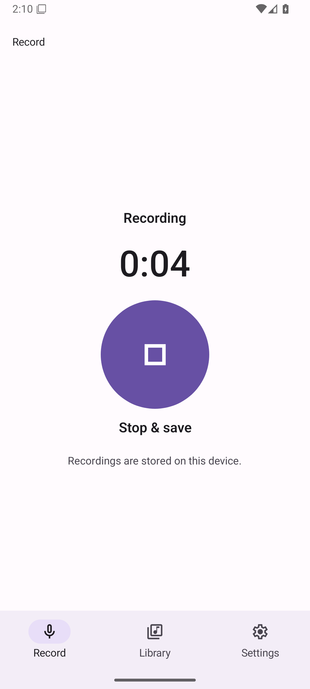
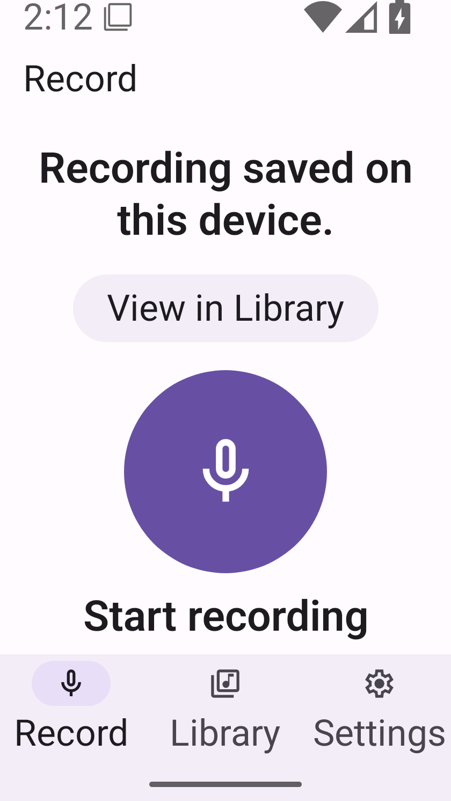

# Centered native recording control — #60

Record now opens with a brief state and a large centered native microphone button, with a visible Start recording label below and one local-storage line. Recording shows the recorder's real timer and explicit Stop & save. Saved offers the existing URI-bound View in Library action, now grouped centrally. Marketing heading, tinted explanation card and repeated offline/account copy are removed. No waveform, service call, permission declaration, dependency or navigation change.

| Before: same-source retained Release launch | After: final-source installed Release |
| --- | --- |
|  |  |

| Recording | Saved | Small screen,200% text |
| --- | --- | --- |
|  |  |  |

## Source and artifact identity

Runtime implementation: `5068e16d13c6e686a0cbbe2c10157699a1de960a`; subsequent evidence-only commits do not alter runtime source. Installed APK was pulled back and matches the built Release byte-for-byte:

- APK SHA256: `d82cbbac0cbb94726c2e53536258c5b79a618e64592d2f4f3e5a11df29df038e`.
- Embedded JS SHA256: `b048e53487190a9f43ce000c05ef1573bcddadbe3bb318ce99db1b26e8d832c6`.
- Android API36 arm64;1080×2400,420dpi; default font1.0, large font2.0; small override840×1491 (320dp wide). Host audio input/output disabled. UTC capture times are authoritative; emulator's displayed local clock uses its default timezone.

[Manifest](manifest.json) gives every original PNG's source, capture time, dimensions, hash and size. Baseline is the owner-supplied, already-verified launch at unchanged remote main `c1cafcce`, not an old saved-state image. Its retained APK/JS attestation is inherited; this task did not access its original device or worktree.

## Local validation

| Check | Result and scope |
| --- | --- |
| Locked Node24 `npm test` | PASS36/36:23 protocol/recovery +13 navigation/handoff tests; offline fixtures |
| `npm run typecheck` | PASS on final implementation |
| Local offline `:app:assembleRelease` | PASS, arm64-v8a; no remote CI |
| Full `:app:lintRelease` | PASS,0 errors/22 warnings; full lint, not just vital lint |
| Actual RecordControl rendered-state contracts | PASS5 phases/45 assertions in a private local harness with stubbed module boundaries: labels, native enabled state, semantics,144dp target and explicit shape radius. This does not exercise native async callbacks. |
| Installed artifact verification | PASS built and installed APK/JS hashes equal |
| Independent code review | Fresh local gpt-6.1-sol medium, exact implementation5068e16 versus baseline: no actionable findings; source-only |
| Independent visual review | Separate fresh local gpt-6.1-sol medium; see review disposition in session docs |

## Actual runtime exercised

- Idle: real Material FilledIconButton, mic icon, visible English label; accessibility tree exposes Start recording as android.widget.Button with144dp square bounds.
- Recording: actual duration progresses; explicit Stop & save and stop icon. Repeated stop taps produce one saved file. Recorder stays active when switching roots and returning (earlier candidate of the same unchanged controller); final-source normal recording captures wait for navigation to settle.
- Saved → View in Library: matching newly saved date/time row highlighted; no autoplay. Explicit Play advances the actual local player's time, Pause retains position. Separate synthetic captures cover multiple recordings, not one continuous screenshot timeline.
- Cold relaunch retains Library files. Transcription/summary/settings service calls were never activated.
-200% text and320dp small screen: start, recording, stop and saved Library action reachable; fixed bottom navigation unobscured. Both recording scroll endpoints are captured. Offscreen content naturally clips; status/timer are not sticky. Scales are applied before capture; live font/display reconfiguration during active recording is not an acceptance claim.
- Permission denial: actual original error message; Start recording reopens the real microphone prompt. Starting is visible beneath the genuine system dialog. No invented Open settings or Retry save action.
- Installed TalkBack: bound service, native keyboard focus/Enter starts recording; Tab reacquires Stop & save and Enter saves. Screenshots show focus. Exact original service/null, enabled0, touch exploration0, font1.0 and display configuration restored. Audible announcements, touch-exploration gestures and physical listening remain NOT_VERIFIED.

## Explicit limits

NOT_RUN: isolated production saving-busy screenshot (too brief in normal local saves), actual stop/save/disk-full/native-start failure injection, telephony interruption, process death during capture, physical microphone/spoken-marker/audio-quality acceptance, iOS/Web runtime, live provider/product quota and any remote workflow. Saving disabled/label behavior has the rendered-state check plus installed native source inspection; neither substitutes for an injected asynchronous native save failure. No mock or fault-injection screenshots are included.

The initial candidate exposed an installed Shape.Circle default-radius discrepancy; final control supplies explicit radius1 and32 vertices through the official API. Failed candidate/transient captures are retained privately and excluded here. A preliminary timing script tapped during scroll settling; the final small-screen save was rerun after settling and observed successful before restoring display.

Shared theme provenance: #57 changed the consumer palette without refreshing its manifest. Only factual localHash/localModifications entries were corrected; theme bytes and sourceHash remain unchanged. Canonical source and release metadata hashes were checked locally. This partial theme record is not full generic-release compliance or Founder acceptance; that release acceptance remains unverified/pending.

No merge, auto-merge, deploy, broader-issue closure or new owner UI approval has occurred. The updated actual UI must be shown to the owner for a new approval before merge.
