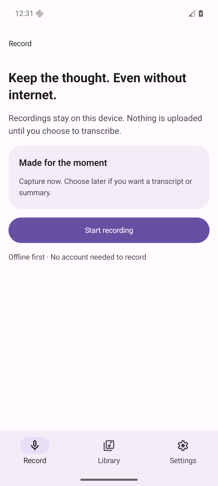
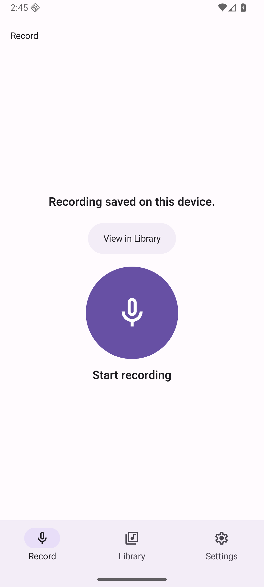
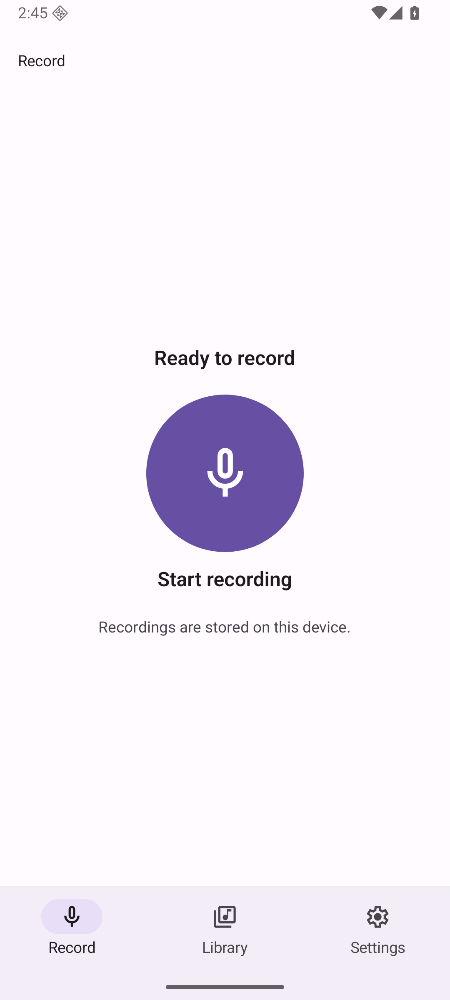
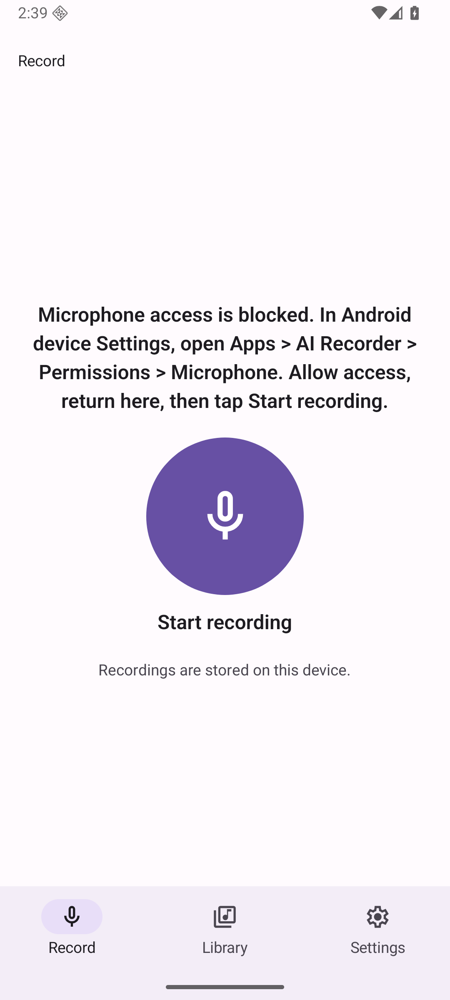

**Latest: bounded frozen-main/candidate A/B complete — 5 PASS / 1 PARTIAL, no reproduced native start error. BLOCKED pending coordinator finite residual-risk decision, not indefinite investigation.** [A/B results, qualifications and recommendation](ab-native-start/README.md). Original error remains NOT_REPRODUCED / NOT_FIXED; no preexisting classification or repair.

# Centered recording control — R1/R2 correction

**BLOCKED pending coordinator residual-risk decision after the bounded A/B packet.** See [latest A/B result](ab-native-start/README.md) and [historical investigation](native-start-investigation.md). Prior successful evidence is not a claim that the original episode was repaired. No owner approval, merge, auto-merge or deploy.

Review package: [PR61](https://github.com/innosage-llc/innosage-labs/pull/61), [issue60](https://github.com/innosage-llc/innosage-labs/issues/60). **Coordinator delivery review is pending. Do not seek owner approval, merge, auto-merge or deploy yet.** Broader acceptance issues remain open.

Record retains its brief native header, centered native144dp circular microphone, visible English Start recording label and one local-storage line. Recording uses actual recorder duration and explicit Stop & save. No waveform, new feature, dependency/Router/SDK change or permission declaration.

| Before: verified retained launch at unchanged main | After: actual final Release cold process launch |
| --- | --- |
|  |  |

## Bounded corrections

R1: saved URI identity outlives transient success feedback. The earlier Record branch checked only idle+URI for the CTA/storage, while its heading fell back to Ready when the message cleared. A single hasSavedFeedback predicate now requires idle+URI+the current success message for both CTA and storage. Navigation, handlers, recorder/player ownership, files and URI identity are preserved. No reset-on-tab-switch or deletion workaround.

R2: existing Expo requestRecordingPermissionsAsync returns canAskAgain. Retryable denial explicitly says Start recording asks again. Permanent denial names the actual manual path: Android device Settings > Apps > AI Recorder > Permissions > Microphone; allow access, return and tap Start recording. No Open settings button, new permission or invented Retry save. Actual system pages and both native response branches were exercised.

| Saved feedback | Playback return: honest idle | Permanent denial: explicit manual path |
| --- | --- | --- |
|  |  |  |

## Frozen source and installed artifact

Final runtime source: `6d5645f34f88ecd940c730eedd96e6529e6c919a`. Later evidence-only commits must match every tracked product file outside docs, including lockfile, against that source; see source-equivalence.json. The pulled installed package equals the built offline Release:

- APK SHA256 `522983e55f30567529bd4a61384c8ebc34c169905800573a5ce931795f4d6997`.
- Embedded JS SHA256 `22422cccec847c87cce73e1d51a8cbcbbdeb86f70eb819c8055d5c4141464575`.
- Android API36 arm64;1080×2400 at420dpi, default font1.0; large text2.0 and small840×1491 (320dp) tested separately. Host audio input/output disabled. UTC capture times are authoritative; emulator clock uses its default timezone.

[PNG manifest](manifest.json) records original bytes, source, dimensions, capture time, hash and size. All updated product PNGs come from this installed final source. The before image is the owner-supplied verified c1cafcce launch baseline; original runtime/worktree was not accessed. Prior candidate after-idle and other historical images are superseded and retained privately, not reused or relabeled as final launch evidence. The new after-idle is an observed force-stop/relaunch without clearing data; cold-library shows the retained synthetic files afterward.

## Checks and actual runtime

| Check | Result and scope |
| --- | --- |
| Node24 npm test | PASS39/39:23 protocol/recovery +16 navigation/handoff/presentation tests. New cases cover stale feedback with retained URI, busy/error exclusions and both canAskAgain branches. Offline fixtures only. |
| Typecheck | PASS on final product source |
| Offline arm64 assembleRelease | PASS local build |
| Full lintRelease | PASS0 errors/22 warnings; full native lint, not only vital lint |
| Native control render contract harness | PASS5 phases/45 assertions with stubbed module boundaries; not native async integration |
| Installed package/embedded JS | PASS equal to built Release |
| Independent code review | Fresh local gpt-6.1-sol medium exact-source review, no actionable findings; source-only |
| Independent visual review | Separate fresh local Sol6.1 medium; findings/dispositions remain explicit in session review.md, not a blanket visual PASS |

Actual final Release evidence:

- Save yields success+View in Library; new recording removes the old success/CTA. State-aware captures validate saved and idle text before accepting those labels.
- View in Library locates the saved row without autoplay; explicit Play advances actual local playback, Pause retains position. Returning to Record gives Ready+storage and no stale CTA while saved files remain.
- Force-stop/relaunch without clear-data gives the same truthful idle; Library retains the prior recordings. No transcription/summary/service API was activated.
- Retryable denial reopens a genuine system microphone prompt on Start recording. A second denial yields blocked/manual-path guidance; retry remains blocked without pretending another prompt opened. Manual system permission recovery then allows recording. Existing optional notification requests are declined.
-200% text and320dp small screen preserve reachable recording/save actions and fixed bottom navigation. Both small recording scroll endpoints are captured. Content outside the scroll viewport clips normally; no sticky timer was added.

During external permission/notification switching, the observed native start path returned its honest start error and a retry remained Starting before failing. A data-preserving cold process relaunch recovered normal capture. Cause is unverified; no recorder-owner reset or new recovery handler was introduced. This is an observed runtime limit, not a controlled native-failure-injection PASS.

No fault-injection/mock screenshots. UI automation uses observed labels for static controls and checks actual phase boundaries; preliminary mistimed or misnamed captures are retained privately and excluded from the delivery manifest. Repeated sequential input that arrives after a completed save is a new Start action; no claim is made that a post-idle tap is debounced. Native busy guards remain unchanged.

## Readiness limits and authority

NOT_RUN/NOT_VERIFIED: actual native start/stop/save/disk-full failure injection, isolated normal saving-busy screenshot, capture process-death/telephony interruption, physical microphone/spoken-marker/audio-quality acceptance, audible TalkBack/touch-exploration gestures, iOS/Web runtime and live providers. Prior TalkBack keyboard focus/activation at5068e16 is historical unchanged-control evidence; it is not relabeled as a final6d5645f runtime check. Render/helper tests do not establish native async save recovery.

Timestamp-only older-file recognition remains out of scope; no titles/previews were added. Saved CTA emphasis versus the expressly approved large central mic remains a documented design tradeoff. The permission-review finding was addressed through truthful copy and an explicit observed manual path, within the no-new-button constraint.

Theme bytes/sourceHash remain unchanged. Earlier manifest localHash provenance was corrected factually; no full generic-release compliance or Founder acceptance is claimed. No dependency/discovery repair, remote CI, merge, deployment or broader-issue closure. Raw Skills/Brain text, prompts, logs, device identifiers and host paths remain private outside Labs. Latest controlled continuation recovered only the same original task AVD:3 trials completed without reproducing the original failure, all7 original Library identities plus3 saves retained after process recreation, production APK/JS reverified, exact initial settings/grants/flags restored, then only that emulator safely stopped. No repair or root cause established. See native-start-investigation.md; BLOCKED remains.
