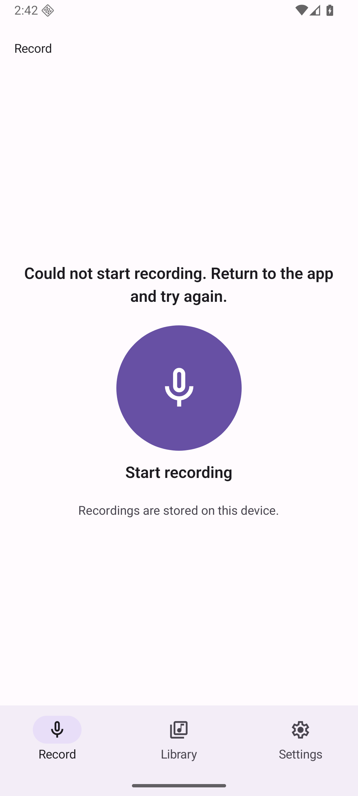

# Native start investigation — BLOCKED

**Readiness: BLOCKED pending native-start investigation. Startup lifecycle is NOT repaired. Coordinator review remains pending; no owner UI/merge acceptance is requested.** This supersedes earlier review-ready language. Production runtime source is `6d5645f34f88ecd940c730eedd96e6529e6c919a`; intake PR61 head was `9c50e7a38bef3b1bb63abf2ad05fd222caf67138`. The R1/R2 screenshot artifact remains `8ae6828889015bf8d711c9c2706c9631471c7a6e`; its successful states are historical evidence, not resolution of this blocker.

## Observed sequence (2026-11-14 UTC)

| Time | Evidence / observation |
| --- | --- |
| 06:39 | Notifications switched off; microphone Ask every time; two native denials produced retryable then permanent guidance. Manual Android device Settings allowed microphone; existing Activity brought front; Start attempted. |
| 06:41 | A save assertion found Starting, not verified Recording. Earlier filenames recording/recording-timer did not establish the phase. |
| 06:42:12 | Actual production screenshot reports Could not start recording. Return to the app and try again. |
| 06:42:47 | Retry screenshot shows Starting. |
| 06:43:58–06:44:06 | Data-preserving force-stop/relaunch, then actual Recording. Subsequent confirmed flow saved, found, manually played/paused and returned to idle with files retained. |

Only one mixed failure episode plus retry is established. Prior own-app PID logcat contains Activity pause/resume and recording-service creation, but no established specific exception or failed awaited stage. Cold-launch recovery does not establish a fix or cause.

This is a **BLOCKER DIAGNOSTIC** screenshot of the production6d error at 06:42:12.302281 UTC, not an accepted UI or diagnostic/mock build. Original PNG SHA256 `d8d742c4e6209f9f14b75fd25602c9e056e89ebf40b4abe6ebdfb1de79ff35ee`, 99816 bytes,1080×2400. See diagnostics/manifest.json. It is separate from the25 successful-state artifact images.

## Observation versus inference

The earlier notification helper queried mCurrentFocus in scoped `dumpsys window windows`; that output need not expose focus. A notification system dialog may have been missed. Several settings, starts and lifecycle transitions were mixed, so causation remains unknown. Neither a missed prompt nor a native service race is established.

Source inspection: start awaits microphone permission, notification permission, audio mode and recorder prepare before synchronous record. The generic catch discards cause. Installed expo-audio source58.0.11 requests Android permissions via the native permissions manager; background-enabled prepare binds its recording service before MediaRecorder prepare. These are candidate observation boundaries, not evidence that any particular boundary failed. Unchanged start-path lines do **not** prove an unchanged-baseline defect.

## Bounded continuation outcome

Read-only verification of the sole authorized task device returned device not found twice. No emulator was started, no other target/server/port/process was accessed, and no app data/settings/permissions were changed. Current installed APK could not be re-read. Prior pulled production verification remains historical: APK SHA256 `522983e55f30567529bd4a61384c8ebc34c169905800573a5ce931795f4d6997`, embedded JS SHA256 `22422cccec847c87cce73e1d51a8cbcbbdeb86f70eb819c8055d5c4141464575`.

- Controlled trials: **NOT_RUN**,0/3; device unavailable under explicit no-startup constraint. Stable reproducibility **NOT_ESTABLISHED**.
- Baseline same-data compatible-build trial: **NOT_RUN; baseline defect NOT_ESTABLISHED**.
- Native failed stage / causal evidence: **UNKNOWN**. No private diagnostic build or instrumentation installed.
- Repair: **NONE**. No product mutation, reset, timeout/cancel/retry workaround or native/dependency rewrite. All45 product/config/lock files remain byte-identical to runtime6d; final head changes docs only.
- Existing exact-source checks remain historical PASS:39 tests, typecheck, offline Release and full lintRelease (0 errors/22 warnings). They do not clear this runtime blocker. No new build/tests or independent code/visual acceptance is claimed for a nonexistent fix. All prior physical audio, TalkBack, native fault-injection and platform limits remain.
- Current saved-file count/persistence and settings restoration: **NOT_RUN in this continuation**, because the device is unavailable. No changes were made; earlier restoration receipts remain historical, not a claim that the emulator is currently available.

## Smallest next diagnostic step

When the coordinator makes the same task-owned AVD available (startup is not authorized in this continuation), verify installed production APK bytes and record Library count/identity and current app permission UI. Run one observed single-action trial with notification state fixed and microphone prompt handled explicitly, checking full foreground window and actual phase. Collect timestamped own-app PID and relevant native service errors. Only if failure reproduces and the catch still hides stage/cause, consider a clearly private, safely signed same-data diagnostic build with stage/error logging. No baseline build before current controlled reproduction. No speculative product fix.

PR61/issue60 stay open and BLOCKED. No merge, auto-merge, deployment, remote CI, duplicate issue, broader acceptance closure, Library upload or Slack message. Raw logs, Skills/Brain/prompts/traces, device identifiers, host paths and audio remain private.
