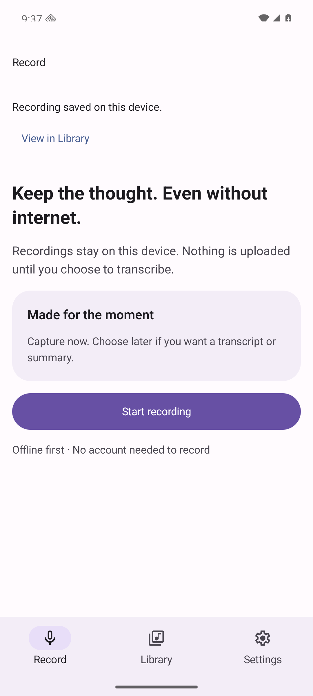
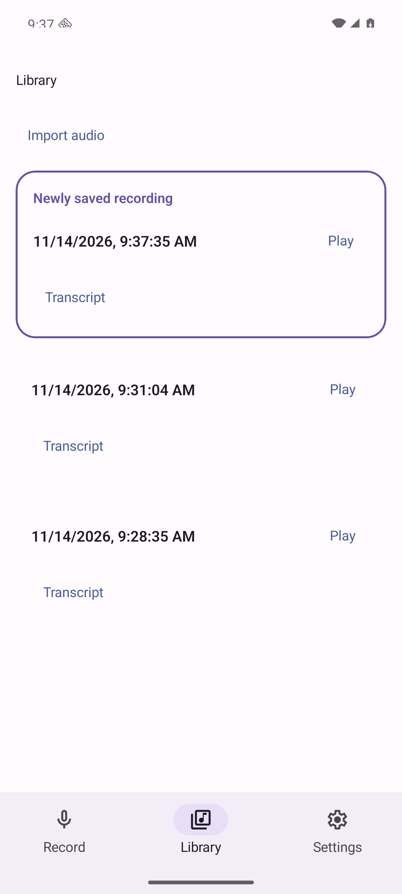

# Saved-recording Library handoff — engineering candidate

Implements [#58](https://github.com/innosage-llc/innosage-labs/issues/58), stacked on the still-open draft [PR #57](https://github.com/innosage-llc/innosage-labs/pull/57). Parent #56 remains open; this packet does not accept the full revamp. Merge remains with the owner.

After a successful local save, the existing native action offers **View in Library**. It locates the exact saved URI, briefly labels/outlines it, and leaves playback stopped. Leaving Library, starting another capture/import or saving another recording cancels obsolete work. Library emphasizes identity/time, explicit play/pause and progress, followed by compact native Transcript; Import is also a compact native text action. Recorder/player ownership remains above root switches.

## Source, build and capture identity

- BEFORE source: `a139eab543734719e1673fccd114d3b9f4772cb2`, unchanged until all BEFORE captures were saved and hashed. These are **new captures for this task**, not the prior audit's screenshots.
- Final code reviewed/tested/built: [`723ffbba6a6eb242c31759c1ba9d03e71f31d895`](https://github.com/innosage-llc/innosage-labs/commit/723ffbba6a6eb242c31759c1ba9d03e71f31d895). Subsequent evidence-only commits do not change app source.
- BEFORE: locally built debug APK, SHA256 `87438b9aab83afe0f609a16618dd655dd4220572670637dd6192fb2cad103aed`, isolated local Metro. An initial launch connected to another Metro; it was excluded and corrected **before** accepting baseline captures.
- AFTER: standalone Release APK, **72,702,521 bytes**, SHA256 `079cbf6e17eeda00594e0ee14527de6ec4736d300a476fedd692148d6db0e314`. Rebuilt on frozen final code; no Metro required.
- Same clean task-created Android 16/API36 Google APIs ARM64 Pixel 8 emulator, explicit serial `emulator-5584`, **1080×2400 / 420dpi / light theme / font scale 1.0**. Only supplementary `18-*` and `19-*` use font scale **1.5**. No shared emulator or physical device was selected.
- Expo 58.0.23, Expo UI 58.0.27, React Native 0.88.1, Node 24.22.2, JDK21. Dependencies installed from the existing lockfile/cache; no SDK/router/manifest change.
- All PNGs are original Android `screencap` output, unaltered. [manifest.json](manifest.json) records each capture's SHA256, size and capture time. The collection grows through the exercises; equivalent states use the same device settings, rather than pretending timestamps/item counts are identical fixtures.

## Direct comparison

| State | BEFORE | AFTER |
| --- | --- | --- |
| Saved feedback | [Saved](before/04-saved.png) | [View in Library](after/04-saved.png) |
| Locate saved audio | [Library](before/05-library.png) | [Exact saved item highlighted, Play untouched](after/05-highlight.png) |
| User-triggered playback | [Playing](before/06-playing.png) | [Playing; progress before Transcript](after/06-playing.png) |
| Explicit pause | [Paused](before/07-paused.png) | [Paused](after/07-paused.png) |

## Actual checks on final code

| Check | Result |
| --- | --- |
| Node24 `npm test` | **PASS**, 31/31: 18 provider/transcript + 13 navigation/handoff |
| `npm run typecheck` | **PASS** |
| `cd android && ./gradlew assembleRelease --offline --console=plain` | **PASS**, including vital Release lint |
| `cd android && ./gradlew :app:lintRelease --offline --console=plain` | **PASS**, full app Android lint |
| JS lint | **NOT_RUN**: no JS lint script/config is defined |
| Fresh independent read-only implementation review | **PASS**, no actionable defects; reviewer independently reran tests/typecheck; [review](implementation-review.md) |
| Installed upstream component inventory | **PASS**, actual upstream script run against this app's installed Expo UI 58.0.27; Button/Host/Slider declarations inspected |
| Remote CI | **NOT_RUN** by instruction; read-only API inspection found zero Actions workflows in Labs and Hub before publication |

The initial shell Node22 rejected the preexisting experimental transform flag; tests were rerun under the supported existing Node24. Initial typecheck found an unavailable React Native type re-export; the final code correction passes. Gradle reports deprecations for a future Gradle10 migration; no dependency upgrade was made.

## Runtime journey coverage

| Exercise | Observed result and actual capture |
| --- | --- |
| Record, navigate roots, stop/save | Active timer survives root switches; saved feedback follows persistence. [BEFORE active](before/02-recording.png), [BEFORE Library during capture](before/03-library-recording.png), [AFTER active](after/02-recording.png), [AFTER Library during capture](after/03-library-recording.png), [saved](after/04-saved.png) |
| Handoff and five-second expiry | Correct newly saved identity shown, Play untouched; label/outline then expire. [Highlight](after/05-highlight.png), [expired](after/05-library.png) |
| Explicit play/pause/progress | AFTER playback advances to 0:02; explicit pause holds at 0:03 of 0:09. [Playing](after/06-playing.png), [paused](after/07-paused.png) |
| Picker cancellation | Existing collection and paused player retained; controls recover, no stale save CTA. [Cancelled](after/08-import-cancelled.png) |
| Local synthetic M4A import | Generated 12-second 440Hz tone imported through the real Android picker; identity retained. [Imported](after/09-imported-tone.png) |
| Player continuity across roots | Tone remains selected/playing after Settings → Library. [Playing](after/10-tone-playing.png), [root return](after/11-tone-root-return.png), [explicit pause](after/12-tone-paused.png) |
| Repeated start/stop and background | Rapid repeated taps yield one new saved identity; recording timer remains active after Home and return. [Background return](after/13-background-recording.png), [disabled playback while recording](after/14-recording-library.png), [saved](after/15-repeated-save.png) |
| Repeated handoff / stale navigation | Repeated tap retains same item and does not play. Leaving for Settings, waiting past expiry, returning yields no stale highlight/navigation. [Repeated handoff](after/16-repeated-handoff.png), [returned](after/17-no-stale-highlight.png) |
| Enlarged fonts and target bounds | At 150%, identity, native actions and roots remain reachable; inspected native action bounds are at least 126px = 48dp at 420dpi. [Large text](after/18-large-text-library.png) |
| Unsupported import | Generated WAV rejected with actionable M4A message and enabled controls; no stale CTA. [Recovery at 150% text](after/19-unsupported-import.png) |
| Persistence / relaunch | Recorded identities and imported tone remain after force-stop/relaunch; no autoplay or highlight resurrection. Tone can then be explicitly played again. [Relaunch](after/20-relaunch-persisted.png) |
| Seek / scroll reachability | Native seek changes paused tone from 0:01 to 0:08 without playback. Bottom row and Transcript remain reachable after scroll. [Paused seek](after/21-seek-paused.png), [bottom](after/22-library-bottom.png) |

Eight assertions over the captured real native UI dumps also passed: saved CTA, cancellation retention, unsupported recovery/no stale CTA, relaunch identities, no relaunch autoplay/highlight, paused seek, leave-highlight cancellation and 48dp enlarged control bounds. Reducer/retry tests cover stale request IDs, repeated saves/taps, cancellation and bounded unmeasured/missing-target retries; they are not mounted native tests.

## Audio evidence and remaining limits

Host microphone/audio was disabled intentionally to exclude personal/ambient content. A recorded baseline M4A was read back from the clean debug app, decoded locally and hashed: **257,140 bytes**, SHA256 `e5f1dbe8eddc93a123be3bb78c2a0a06f5eae64bd52a65297f99a9bb8e1d6963`, **20.223129 seconds / 891,840 decoded frames at 44.1kHz**. Its peak amplitude is 11/32768, near-silent emulator input. This verifies actual local recording/container/decoder/storage behavior, not microphone fidelity. The generated imported tone separately decodes to 12 seconds with peak 7110 and RMS 4949.73; native playback progresses, pauses and seeks after relaunch.

**NOT_RUN / acceptance limitations:** audible listening and physical microphone/speaker quality; TalkBack focus/announcement/navigation; process death during active capture; actual disk-full/save failure; telephony/audio-focus interruption; iOS/Web; full parent #56 and design-workflow acceptance. Native UI labels/bounds and enlarged-font screenshots do not certify a screen reader. Locating an offscreen unmeasured target is regression-tested in the retry helper, while the real saved item is the newest row in this app's ordering. Very large collections were not stress-tested.

No personal audio/text, keys, audio upload, external transcription, billable service request, deployment or merge. This remains a **draft engineering candidate with explicit device/audio/accessibility acceptance limits**.
