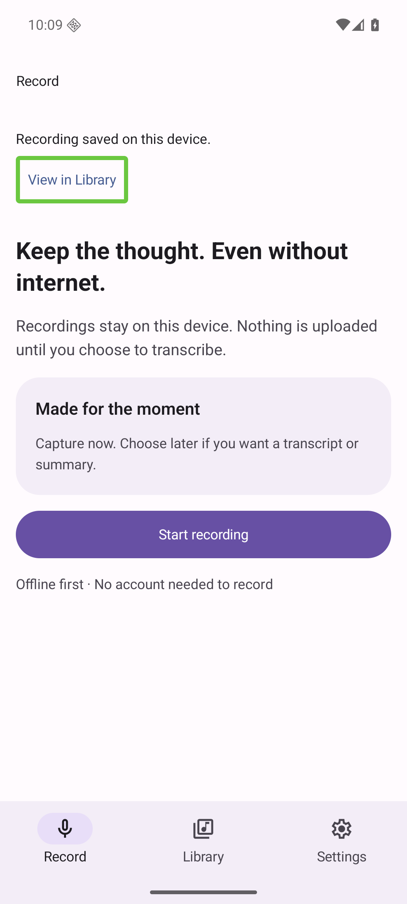
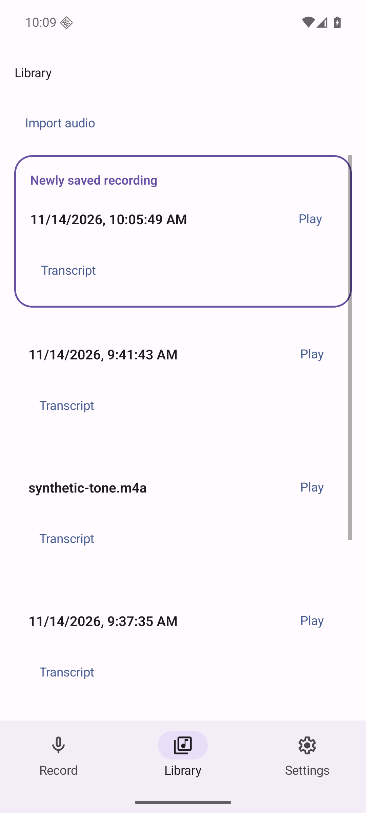
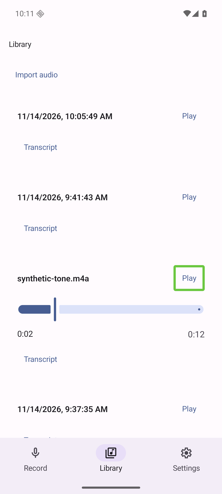
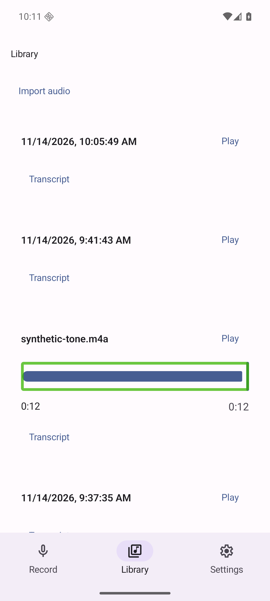

# Bounded readiness continuation — 2026-11-14

This adds actual TalkBack interaction evidence to [issue58](https://github.com/innosage-llc/innosage-labs/issues/58) and [draft59](https://github.com/innosage-llc/innosage-labs/pull/59). The original [before/after packet](../README.md) is preserved. No product code changed; no merge, retarget, rebase, deployment or acceptance is asserted.

## Stack assessment

Remote main is `1b2f65db949138a7dd2e207345717a672561039a`; [draft57](https://github.com/innosage-llc/innosage-labs/pull/57) remains open at `a139eab543734719e1673fccd114d3b9f4772cb2`. Draft59 remains based on its feature branch. Its app code remains `723ffbba6a6eb242c31759c1ba9d03e71f31d895`.

PR57 creates `ui/ActionButton.tsx`, which main lacks and PR59 imports and extends. PR59's `App.tsx` handoff and hierarchy edits also use PR57's RecorderScreen layout/style context (`recordingCard`, `notice`, native ActionButton usage and service-label context). Main already has root-level recorder/player state, RootNavigation, FlatList and the theme API. PR57 changes theme palette values and selected-root indicator styling; those affect the reviewed appearance. SDK58 dependencies, lockfile and navigation implementation are unchanged between main and PR57. PR57 additionally changes transcript, summary and settings recovery/disclosures beyond issue58's two changes.

A dry-run `git apply --check` of only PR59 app-code changes onto an archived main failed on App.tsx and missing ActionButton.tsx. No patch was applied. Even a clean patch would not establish equivalent behavior or appearance. Directly retargeting the existing PR would expose all PR57 changes against main, not make the two-change scope independent.

| Option | Review/merge implications |
| --- | --- |
| **Recommended: preserve stack; owner reviews PR57 first, then PR59 delta** | Preserves the authorized UX and existing evidence. Requires predecessor acceptance. If PR57 is squash merged, separately reconcile/review PR59's history/base against resulting main to avoid duplicate comparison; no automatic rewrite now. |
| Owner-approved combined review of PR57+59 against main | Makes the wider scope visible, but requires all PR57 acceptance and is not independent. |
| New minimal port to main | Requires reconstructing the wrapper/App edits and explicit theme choices, plus fresh source/runtime review. May undo approved UX if done mechanically. Additional implementation decision, not performed under bounded readiness. |

The stack is unchanged. Parent [issue56](https://github.com/innosage-llc/innosage-labs/issues/56) remains open; these checks do not accept its full revamp.

## Actual TalkBack runtime

The already-installed frozen standalone Release APK was read back from the task emulator and its SHA256 matched `079cbf6e17eeda00594e0ee14527de6ec4736d300a476fedd692148d6db0e314`. API36, 1080×2400, 420dpi, font scale1.0; TalkBack16.0.0.738667889. No APK/software install, app/OS permission change, Metro, external upload or paid call. Only the task-owned emulator was modified. Host audio/microphone stayed disabled. A single near-zero-duration synthetic save was created during initial input-path discovery; existing synthetic tone supplied meaningful playback duration.

TalkBack was enabled using its exact installed service, confirmed bound with touch exploration enabled. ADB `input tap/swipe` bypassed the expected exploration path and keyboard shortcuts did not visibly navigate; those probes are **not** counted as TalkBack success. Supported emulator hardware touchscreen events (`emu event mouse`, touchscreen device0) did provide actual single-touch accessibility focus and double-tap activation. Green focus, activation transitions and progress are captured below. No custom service or simulated feedback was substituted.

| Check | Exact observed result |
| --- | --- |
| View in Library focus/activation | PASS visual interaction: single hardware touch focused native CTA without navigation; double tap opened Library, located newly saved row and showed its temporary label/border. No autoplay/player appeared. |
| Saved row announcement | NOT_VERIFIED: highlight visible; no utterance text captured and no listening claim. Focus was not automatically shown on the saved row in the immediate handoff screenshot. This is not evidence of announcement failure or success. |
| Native Play/Pause | PASS visual interaction: single touch focused Play; double tap showed focused Pause. Synthetic tone progressed0:00→0:02 of0:12; double tap paused at0:02 with Play displayed. |
| Seek | PASS bounded gesture: paused slider received TalkBack focus; double-tap-and-hold drag moved0:02→0:12 while Play remained displayed. Single upward-swipe probe moved focus to preceding row identity rather than adjusting; no keyboard/reading-control seek claim. |
| Root return/stale state | PASS bounded interaction: focused/double-tapped Record then Library. Saved CTA absent on return to Record; highlight did not reappear; no autoplay. |
| Import cancellation | PASS bounded interaction: TalkBack-focused/double-tapped Import opened native picker; Android Back cancelled; settled Library retained rows and paused state. Back was injected as a system key, not claimed as a TalkBack gesture. |
| 48dp/150% font | NOT_RERUN this continuation. Original packet contains native bounds and enlarged-font checks; no new large-text TalkBack claim. |
| Spoken feedback/listening | NOT_VERIFIED. TTS connection was observed, but no reliable full utterance stream or audible output was captured. Host audio disabled. |

These are actual TalkBack interaction checks, not full accessibility certification. No actionable app defect was established within the two approved changes. No source fix or new implementation review was needed. Prior independent source/evidence reviews remain separately scoped; this new packet is not independently runtime reviewed.

## Restoration and gates

Before: `enabled_accessibility_services=null`, `accessibility_enabled=0`, `font_scale=1.0`. After: exact same values. Original absent services setting was deleted (not replaced by a literal `null`); accessibility disabled. Readback: bound services empty, touch exploration false. No other service was enabled, no TalkBack preference changed. An optional TalkBack notification permission prompt was left ungranted; Home/app switching avoided it. Task emulator was shut down after restoration. Shared emulator/physical devices were untouched; no private serials are published.

`git diff 723ffbb HEAD -- App.tsx ui package.json package-lock.json` was empty. This continuation did not rerun unrelated builds/tests: original final-source gates remain31/31 tests, typecheck, assembleRelease and full lintRelease PASS; they are previous execution results, not new runs. New artifact/hash/restoration/source checks PASS. Remote CI is intentionally NOT_RUN (zero workflows; no Actions triggered).

Human acceptance still requires spoken-feedback/announcement and audible-listening checks on an appropriate device, physical microphone/speaker quality, and the existing active-recording process-death/disk-full/telephony-interruption limits. iOS/Web and parent56 acceptance remain outside this packet. Owner controls predecessor acceptance and any subsequent merge/base reconciliation; all drafts remain open.

## Runtime originals

All files below are original runtime screenshots, unchanged. [Manifest](manifest.json) records exact hashes/source/APK/runtime. The capture sequence includes failed input probes locally, but only the clearly described hardware-path observations are selected here.

[12-hardware-cta](12-hardware-cta.png)

[13-activated-library](13-activated-library.png)

[17-play-focus](17-play-focus.png)

[18-play-activate](18-play-activate.png)

[24-tone-progress](24-tone-progress.png)

[25-tone-paused](25-tone-paused.png)

[26-slider-focus](26-slider-focus.png)

[28-seek-drag](28-seek-drag.png)

[30-record-return](30-record-return.png)

[32-library-stale-check](32-library-stale-check.png)

[34-picker](34-picker.png)

[36-picker-return](36-picker-return.png)

