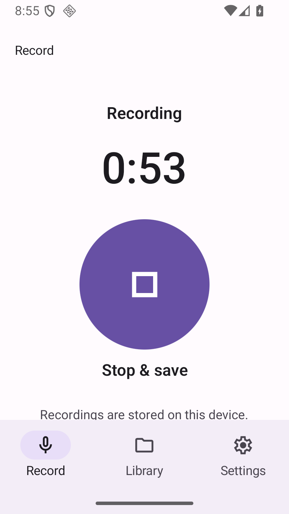
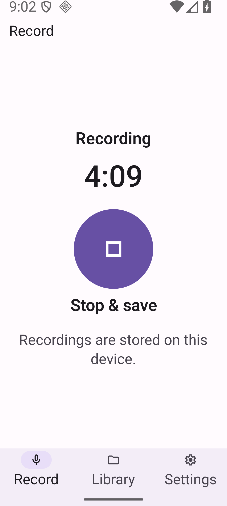
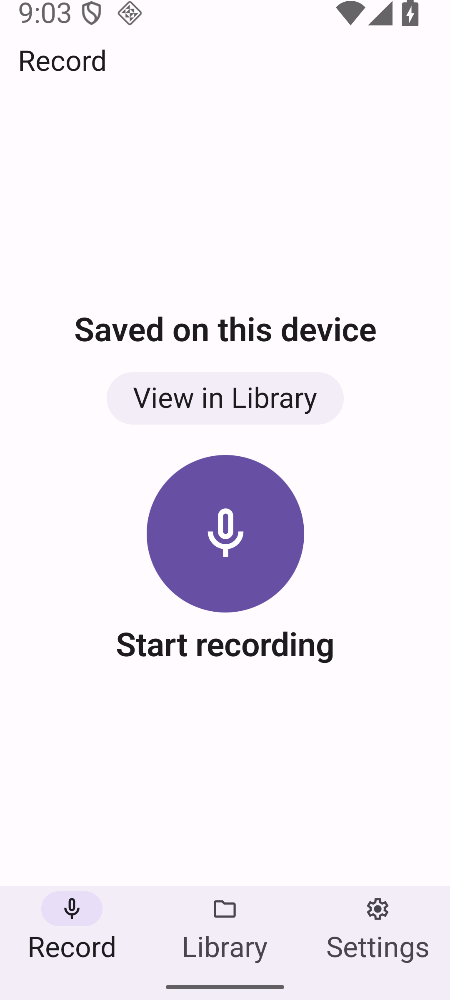

# Recorder ownership across Activity recreation

The configuration interruption in [#66](https://github.com/innosage-llc/innosage-labs/issues/66) reproduced in C1/C2. A font-only change replaced the Activity/React screen within the same JavaScript runtime. The screen-owned `useAudioRecorder` instance was released with that screen; the replacement screen had a different, idle recorder. Capture stopped without the original screen's normal save completion. The interrupted AAC files remained valid in cache and unlisted in Library. This evidence supports an ownership interruption, **not permanent file loss** or an explanation of the separate historical startup failure.

The fix moves the recorder, phase, in-flight start/stop guards, completion subscription and single-save state into one app-scoped `CaptureSession`. Screens subscribe to its snapshot and detach rendering subscriptions without releasing the capture owner. Completion/save and the saved URI survive a screen gap. The public installed `AudioModule.AudioRecorder` API receives the same platform-flattened HIGH_QUALITY options as the existing hook. No dependency/native SDK changes, configuration suppression, reset/retry/timeout or UI redesign were introduced.

Playback remains screen-owned. A token-based binding resolves the **current** player's pause action after microphone and notification permission awaits. Old cleanup cannot remove a newer binding; a gap has no disposed-player callback. Active-player errors still reach normal startup feedback. Permission denial still precedes pause. This corrects a privately reviewed candidate defect before installation; it is not attributed as the historical #65 cause.

The tradeoff is an intentionally retained recorder and completion listener for the current JavaScript runtime. Activity/React recreation is covered; process death, runtime replacement, durable journaling and recovery of interrupted cache files are not. Native context teardown remains distinct from screen detachment.

## Bounded runtime results

Exactly **S5/5 and C5/5** actual Start inputs were consumed, each journaled before input; **zero unused slots**, no S6/C6. The [attempt matrix](attempts.json) retains actual UTC/input times, outcomes, saved container information and SHA-256 identities of private scoped logs. Raw logs, native paths and audio remain private.

| Slot | Artifact / factor | Actual outcome |
|---|---|---|
| S1–S5 | Baseline product logic, private diagnostics | Four advancing captures saved; one separately numbered expected microphone-denial Start. No matching generic startup failure. |
| C1 | Baseline, font-only | Capture owner interrupted; valid AAC remained unlisted in cache. |
| C2 | Baseline, font-only confirmation | Same interruption; protected deferred cleanup read could no longer resolve old recorder. |
| C3 | Corrected fix with protected private observations, font-only | Activity/screen recreated; same recorder ID/URI and recording phase retained, post-cleanup read still recording; one normal completion and one save. |
| C4 | Product fix without diagnostics, size-only | Timer advanced through size change with font/density fixed; normal Saved feedback and unique valid AAC output. |
| C5 | Same installed product, warm second capture, font-only | Timer advanced through font change with size/density fixed; normal save and valid AAC; Library handoff showed no autoplay, explicit Play advanced and explicit Pause held position. |

C3's private logger and synchronous metadata/hash probes add overhead. C4/C5 used the separately frozen product artifact with diagnostic markers/methods absent. They establish observed timer/save/file behavior; no instrumented per-event native completion count is claimed for C4/C5. [APK/embedded-JS identities](artifacts.json) distinguish these artifacts. All updates retained package/version/signer, schema and permissions.

| Product size-only continuation | Product font-only continuation | Saved feedback |
|---|---|---|
|  |  |  |

[Original screenshot manifest](screenshots.json) records unmodified PNG hashes. [Library handoff](screenshots/C5-library-handoff.png), [explicit playback](screenshots/C5-explicit-playing.png) and [paused position](screenshots/C5-explicit-paused.png) are separate observations. Host audio input/output remained disabled; acoustic quality and playback of every old file were not tested.

C1/C2 cause confidence rests on runtime identity/phase evidence and the installed hook's deferred release, registry removal and native release path. The C2 read is an observer with timing caveats, not an explicit native release-event log. The unchanged hook teardown alone was originally a hypothesis; the paired runtime observations supplied the matching evidence.

## Gates and limitations

Final product source passed the aggregate **64 tests** (23 transcript/service, 16 navigation, 25 capture/binding), typecheck, offline Android Release and root `lintRelease` across native modules. Lint produced 37 warnings and zero errors across eight reports. New tests execute the real session class through screen detachment, pending start/stop/save, completion deduplication, microphone/notification awaits, absent/overlapping playback bindings, active callback errors and denial ordering; AST integration checks the actual App binding. No new dependency or test runtime flag was added.

The first private diagnostic had eager getter arguments that could alter product flow. It was corrected before installation: all probes use protected lazy payloads, including error-marker failures, with isolation tests. Original/corrected diffs, the failed SDK-discovery build, later successful builds and actual logcat truncation/chunking receipts remain private. Logging-only observations do not claim identical production timing.

The environment recovery/reconciliation completed in 25m18s, E1 only; no E2 or later boot. The per-process `-feature -WiFiPacketStream` flag is an environment difference, **not a product fix or proven recording cause**. Open-file/inode evidence corrected an earlier copy attribution: the running guest used the earlier independent task working copy; the extra prepared recovery copy was unused. The wrong attribution is preserved historically; selection cause remains unproven. Other runtimes, protected original/backup and shared ADB were not modified by product operations.

The [separate startup report](startup.md) supports only the owner-authorized **“no consistent reproduction”** disposition for #65 after five baseline Starts. The historical generic failure remains unexplained; it is neither fixed nor shown absent. #66 remains open pending new fix acceptance, and umbrella #60/#56/#58 remain open. Final independent code/visual review is requested separately; no review PASS, owner acceptance, merge or deployment is claimed here.

## Final preservation and restoration

[Final restoration and audit identities](restoration.json): all17 original +7new saved =24 Library identities were re-enumerated on the exact restored production artifact. All24 pre-fix audio files and the C3 output retained their SHA-256/byte sizes; all27 final containers had valid AAC metadata. C1/C2 cache files remain preserved and unlisted. Initial font/display/rotation/accessibility settings and microphone/notification grants plus flags match exactly. Only the owned task copy was gracefully stopped; its ports and handles closed. All22 protected files in each of original and cold backup were rehashed (44 comparisons), zero mismatches. Shared ADB remained unchanged; working-copy boot writes are retained.

Permission revocation normally terminated the app during cleanup. The pid-dependent observation helper then stopped on process absence; its failure was preserved, and read-only package/foreground checks completed restoration proof before a fresh production launch. This was not a recording failure or extra trial. Final independent code/visual review remains pending.
