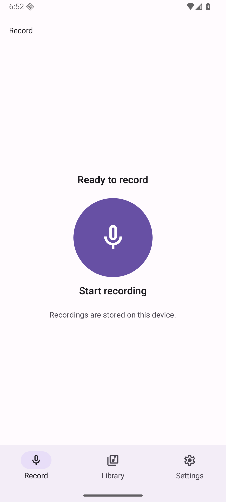
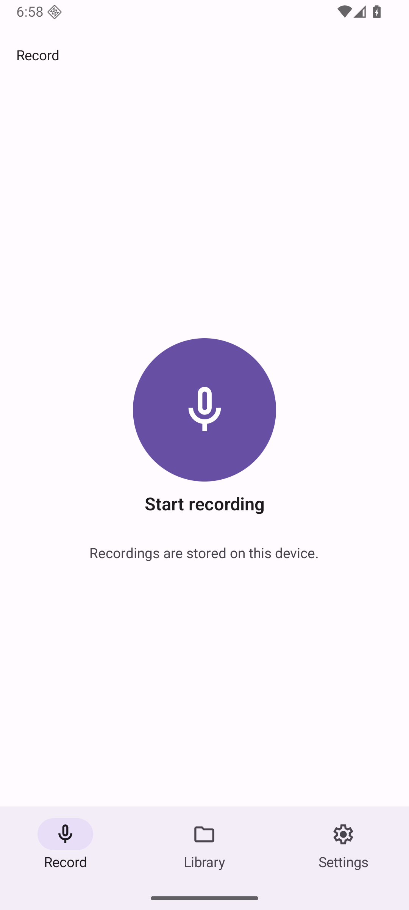
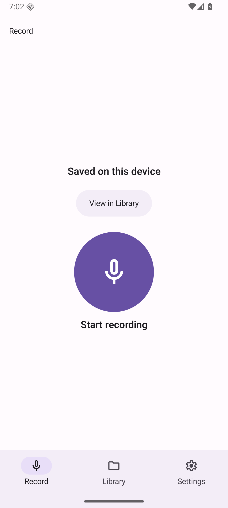
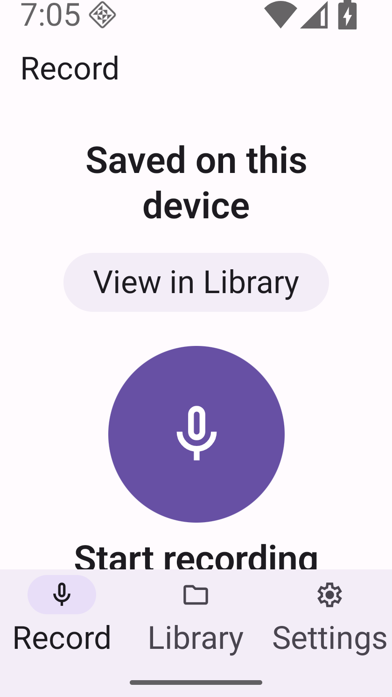
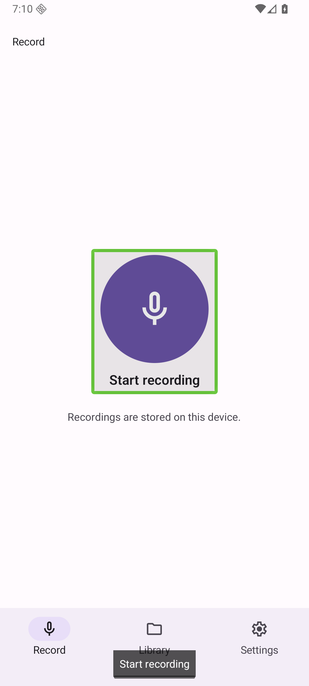
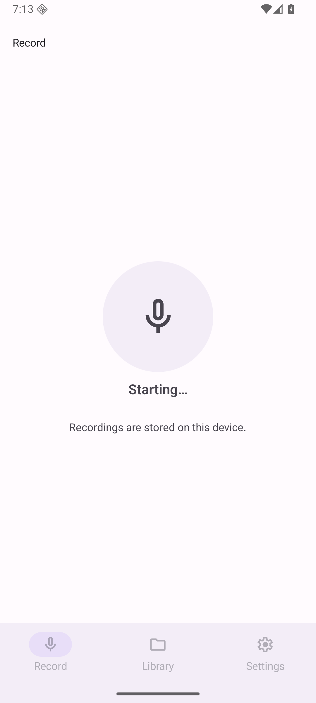
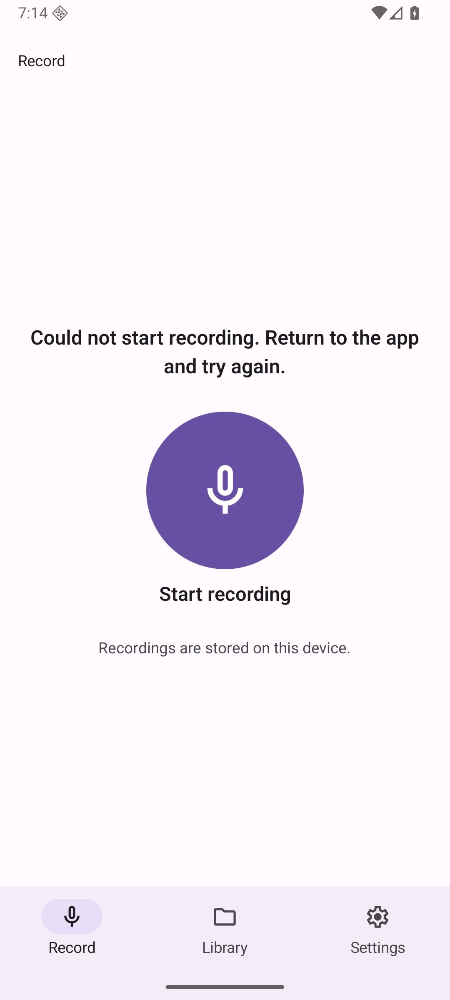

# Single native Record action — bounded follow-up to merged PR61

**Implemented; draft handoff with a new observed native-start failure. Do not merge, enable auto-merge or deploy.** Parent owns delivery of these updated actual UI images and fresh approval. Previous approval applied only to merged [PR61](https://github.com/innosage-llc/innosage-labs/pull/61). Tracked in [issue60](https://github.com/innosage-llc/innosage-labs/issues/60); broader #56/#58 remain open.

Baseline remote main was reverified and frozen at `40d95184a1e7c903b3994818767e59357bbf7392` (tree `27d5d1228b21205207b262e3922ad4561d79819a`). New isolated source/worktree; no reuse/reset of the prior source branch. This main tree has the same product bytes as the prior production source. The actual before images were captured from the newly owned copy's installed release, not reused historical images.

| Actual default baseline | Actual updated default |
| --- | --- |
|  |  |

The144dp circle remains; idle Ready is omitted. One native Material TextButton contains circle and visible action name. Its bounded ripple/focus region surrounds that actual content group; this is the tradeoff versus the previous circle-only indicator. There is one action handler/disabled owner, no duplicate button or hidden overlay. Saved feedback is exactly **Saved on this device**. Library uses the installed Material folder icon instead of a music-note library; destination, size, labels and navigation remain unchanged. [Control/API decision and omissions](decision.md).

## Frozen source and artifacts

- Production source: `9d199559f96aedd019d56ee374de8888460eee4c`.
- Actual installed production APK SHA256: `1d3581f6f19773a5122647c11916d867608fda91672cfd0abfa48640819b5dee` (26,102,283 bytes).
- Embedded JS SHA256: `ceb030d7262c0e68a7734201ddd512e9a966b1edc8daa95854d40847685a9a0f`.
- Same signer/package/versionCode10/version0.1.9 and unchanged storage schema verified before compatible install-r. No clear, uninstall or downgrade.
- Android API36 arm64; default1080×2400@420dpi/font1.0; small840×1491@420dpi/font2.0 (320dp). Host microphone/output disabled; only synthetic recordings.

[Original PNG byte manifest](manifest.json) records actual source/APK/JS, dimensions/font, UTC, hash and size for every image. Later packet commits are documentation/evidence only; [product source hashes](source-equivalence.json) establish equivalence to the tested source. No final documentation head is claimed to have had a new build.

## Gates and actual outcomes

| Gate | Result and precise scope |
| --- | --- |
| Expo routing dependency gate | PASS, before official overview read; pinned revision `a9e5bd3fa00b4e61f632e43f85da73aee1942582`; actual installed inventory/types/Kotlin inspected |
| Local Node24 tests | PASS39/39 (23 protocol/recovery +16 navigation/handoff) |
| Typecheck | PASS on frozen production source |
| Offline Release | PASS local arm64 assembleRelease |
| Full native lintRelease | PASS0 errors/22 warnings; not merely vital lint |
| Private source render contract | PASS5 phases, one callback owner/shared disabled styling; stubbed boundary only |
| Actual native control harness | PASS5 externally set phases: icon+label plus3 further taps produce0 callbacks while starting/saving/importing, exactly5 while idle/recording. One actionable parent and native enabled=false verified. [Binding/results](native-harness-results.json) |
| Production icon/label hits | PASS icon Start→label Stop/save, then label Start→icon Stop/save at200%/320dp; two distinct saved identities retained |
| Full production journey | PASS first save→View in Library without autoplay→explicit Play0:00→0:03→Pause→two fresh Play+0:04/1:11 observations4.38s apart→Record idle |
| Real TalkBack | Observed one focus group over circle+label, one displayed speech-output phrase “Start recording,” then Record navigation. Audible speech/physical audio NOT_VERIFIED |
| Extra third start | **FAILED**: actual Starting… followed by existing Could not start recording…; no retry, reset, speculative timeout or native repair |
| Extra background return / small Saved bottom-scroll | **NOT_RUN** after that third start failed; initial Saved small viewport clips lower Start label. Source is scrollable; complete final scroll visibility is not claimed |
| Remote CI | NOT_RUN; current repository workflow inventory0, retain LOCALCI; no remote workflow added |
| iOS/Web/providers/physical audio/controlled disk or native faults | NOT_RUN, outside this bounded Android scope |

The native harness is explicitly marked TEST HARNESS in its images. It uses the identical production RecordControl source hash with external phase/count state, no recorder/persistence/provider. Its APK/JS are separately identified. It validates actual native input/disabled behavior, not real async start/save timings or faults. Exact production APK was restored and read back afterward. Enabled harness repeated taps each intentionally produce one callback; no post-idle debounce behavior is introduced or claimed.

| Real save | Real200%/320dp save initial viewport | Real TalkBack displayed output |
| --- | --- | --- |
|  |  |  |

## New failure and evidence limits

The extra third production start was intended to verify a bounded Home/return interruption and capture the full small Saved scroll path. After the private native harness had been replaced with the verified production APK, a normal Start/one-time microphone grant first showed Starting… and later the existing start-error message. It produced no successful save. No failed stage or cause is established; install/permission sequence is context, not a causal conclusion. No baseline replay, native-start diagnosis, force-stop recovery, retry or production fix was attempted. The UI implementation cannot be called fully runtime-accepted with this disclosed failure.

| Actual third Starting | Actual subsequent error |
| --- | --- |
|  |  |

The original06:42 episode remains **NOT_REPRODUCED / NOT_FIXED**, cause/stage unknown; this newly observed failure does not explain that episode. Historical six-slot A/B remains **5 PASS /1 PARTIAL**, unchanged and not replayed. Existing evidence/risk remains in issue60 and the merged PR61 packet.

Live timers made fresh hierarchy extraction unavailable during recording. The failed assertion was preserved, no stale XML was used, and actual production PNG plus local system Vision OCR supplied the immediately preceding control observation for Stop/Pause inputs. Pause input followed its actual pre-input capture in the same script (about0.53s to invocation); no26s cross-tool gap. The paired paused positions establish only that observed interval. Other corrected automation assumptions (oversized enumeration swipe, text child versus action parent, initial TalkBack injected tap activating rather than exploring, settings grouping versus actual radio control) remain private audit evidence, not product PASS results.

## Independent reviews

Fresh independent read-only gpt-6.1-sol medium CODE review of exact9d19955 and installed types/Kotlin: no actionable source findings. Separate fresh independent VISUAL review inspected12 original production PNGs plus4 supplemental actual TalkBack/Starting/error images: no material visual defect; confirmed the new runtime error and left small Saved bottom-scroll evidence unresolved/NOT_RUN. A clipped initial viewport is not proof of an unreachable action. Static screenshots do not prove semantics, hits, advancing time or audible quality. No owner acceptance is claimed.

## Data, restoration and publication

[Final safety/data ledger](safety-ledger.json) records the original13 exact display identities, two authorized new saves (expected15), failed third attempt with no new saved identity, final installed APK and settings/shutdown state. The stopped old candidate was copied with all data/key/backing files verified independent before boot; all chains stayed inside the new owned copy. Original profile and old candidate were not booted or modified. Only owned resources were operated; no ADB server restart/root, other AVD or physical device activity.

[Sanitized routing ledger](routing-ledger.json) retains revision/read receipt hashes and selection/omissions. Original routing/gate/inventory/source-read receipts and full audit remain private in the controller; no Skills/Brain/raw traces/logs/host paths/serials/keys/audio are published. Existing theme/manifest bytes remain unchanged. No dependency, SDK, router, release, tool installation, provider call, Slack/Library upload, owner message or approval request.

## Later bounded continuation

[Two-Start diagnosis/evidence continuation](continuation-60m/README.md): Draft62/BLOCKED retained. Diagnostic sample succeeds; production configuration-transition interruption prevents P2 Saved fullscroll. Earlier failure remains unexplained. Original evidence above is historical; latest final state is16known identities, exact production/settings restored and owned resources stopped.
