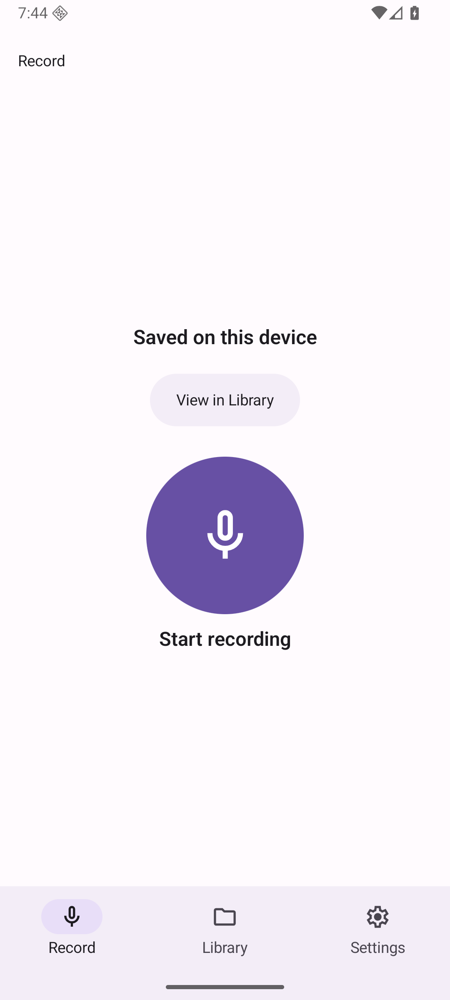
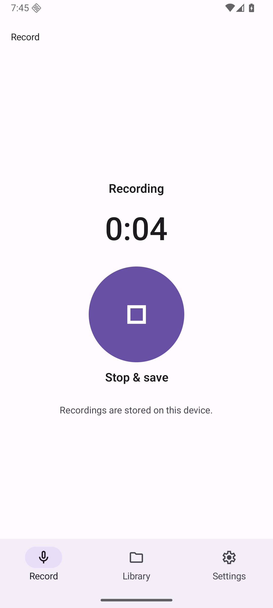
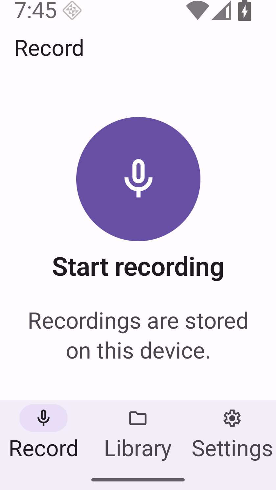

# Bounded continuation: Draft PR62 remains BLOCKED

This is a new diagnosis/evidence budget, not owner acceptance or an extension of PR61's risk acceptance. Linked [PR62](https://github.com/innosage-llc/innosage-labs/pull/62), [issue60](https://github.com/innosage-llc/innosage-labs/issues/60), and merged [PR61](https://github.com/innosage-llc/innosage-labs/pull/61). Existing evidence and risks remain intact. Broader issues56/58 remain open.

Budget started2026-11-14T11:31:55Z, deadline12:31:55Z. Exactly **2/2 Start actions** were consumed, with STARTED written before each input. Owned runtime was gracefully stopped and verified closed at11:50:12.899Z, 18.30 minutes into the budget. No additional Start, retry, reset, timeout, product repair, merge, deployment, owner approval request, upload to Slack/Library, provider call or dependency installation occurred.

## What was established

| Slot and hypothesis | Actual observations | Outcome / limits |
| --- | --- | --- |
| 1 — private stage diagnostic: identify an awaited boundary if failure recurs | Actual one-time mic grant and notification denial; mic request, notification request, audio mode and prepare completed; record call returned. Actual timer0:00→0:04, Saved, one diagnostic Library identity | SUCCEEDED for this sampled diagnostic sequence. Notification return is not permission grant. Logging has timing overhead. No recurrence or failed stage was obtained; not production P2 proof |
| 2 — exact production: one save for320dp/200% Saved full-scroll proof | Actual icon Start→Recording0:00→0:04. Test changed screen size and font during active capture. First small PNG showed idle Start recording before any Stop/save input | FAILED evidence attempt at configuration transition. Same process and ActivityRecord; native trace shows React surface startup/old-surface teardown and Running main. No new generic start error. No production Saved obtained |

Both size and font changed together. A React surface/app remount is supported; a process restart, isolated trigger, exact recorder ownership after remount, permanent audio loss, or a shared cause with the earlier startup error is **not established**. Actual native stopped-surface teardown messages were preserved privately. No identified audio-start exception was obtained. The meaningful failure was preserved immediately and trial work stopped. No fix is proposed without a separately bounded coordinator decision.

**P2 remains NOT_RUN/unfulfilled:** actual production Saved full-scroll at320dp/200%, lower label/native bounds above fixed navigation, return-to-top handoff and lower-action activation were not obtained in this continuation. Lower activation is NOT_TESTED. An idle small image and diagnostic Saved image cannot substitute. No baseline Start was replayed; regression attribution is UNPROVEN.

| Private diagnostic actual Saved (not production acceptance) | Exact production timer before transition | Exact production small idle after transition (not Saved) |
| --- | --- | --- |
|  |  |  |

## Earlier failure reconstruction and comparison

The previous third Start followed private harness→verified production replacement. Host-side sequence:11:12:58–11:13:01 actual idle;11:13:38.721 Start label;11:13:39–41 actual mic dialog;11:13:41.191 Only this time;11:13:41.854 Starting;11:14:33.352 generic start error. The wrapper's premature Recording assertion occurred before Home or display changes; no background action took place. Guest own-service creation at11:13:41.458 is consistent with native prepare/service binding, but does not establish a completed await, rejecting operation or root cause.

No contemporaneous exact foreground Activity/PID snapshot, notification result/dialog, grants/flags or per-await exception exists for that old attempt. Later permission observations cannot fill those gaps. Host input/capture timestamps and guest log clocks are separate; apparent subsecond offsets are not treated as a causal ordering contradiction.

PR61's original episode had manual permission/Settings/foreground transitions and later force-stop recovery. Its original cause/stage remain **NOT_REPRODUCED / NOT_FIXED**. The later controlled A/B **5 PASS /1 PARTIAL** remains unchanged. Generic error wording, unchanged source lines and this diagnostic success do not establish a common cause or fix. The newly observed PR62 third-start **FAILED** remains a separate unexplained observation. PR61 risk acceptance does not authorize PR62 acceptance.

## Source, artifacts and gates

Production source remains `9d199559f96aedd019d56ee374de8888460eee4c`; all45 tracked non-doc app/config/lock hashes match. Intake docs head was `83ce3fc8491f46b823e489511c0e7946039a6f35`; later commits contain evidence/docs only. Remote main was reverified `40d95184a1e7c903b3994818767e59357bbf7392`.

| Artifact | APK SHA256 | Embedded JS SHA256 |
| --- | --- | --- |
| Exact production, installed/read back before slot2 and before shutdown | `1d3581f6f19773a5122647c11916d867608fda91672cfd0abfa48640819b5dee` | `ceb030d7262c0e68a7734201ddd512e9a966b1edc8daa95854d40847685a9a0f` |
| Private diagnostic, base source above + App-only stage/error logs | `8f8d1d5674dc152aad7229a106b75a97ece39e30f7afcd7ec58187e8dd9bd2a8` | `da1f4b93f6753cd1f8eb29ea2f5f5ce943d63769708de98b6f534f8d907fe5b4` |

Diagnostic diff SHA256 `d9f21c9f805014fadae5ff65ae77387ca5a3f605c4b3cd5dec7adb1aac1abfac`. Same signer/package/version/schema/native configuration/permissions were verified before compatible install-r; no data clear/uninstall/downgrade. It preserves original lifecycle, guards, returns, recorder calls, catch recovery and operation order. No instrumentation is committed to product source. An initial artifact-marker gate blocked the still-old build output before packaging completed; no install or Start occurred in that gated attempt.

Dependency routing gate recheck PASS, Node24.22.2 unchanged. Historical production39 tests/typecheck/offlineRelease/full native lint PASS remain historical, **NOT_RERUN** because source did not change. Private diagnostic typecheck and offlineRelease PASS; diagnostic full lint NOT_RUN. Remote workflow inventory remains0; retain LOCALCI, no new remote workflow. iOS/Web/provider/physical-audio/native-fault tests NOT_RUN. Audible TalkBack remains NOT_VERIFIED; no TalkBack setting changed this continuation.

## Independent review and disposition

A real fresh read-only gpt-6.1-sol medium CLI review inspected six actual PNGs, pinned source, diagnostic diff, ledger, scripts and original state/log receipts; invocation and original JSONL output are retained privately. It identified the configuration-transition interruption, missing P2, then-pending cleanup and incorrect0:03 timer wording. Timer wording is corrected to0:04; remount is distinguished from process restart. Default controls are readable/separated; small idle text wraps and navigation remains visible but tight. These static observations do not prove Saved reachability, touch semantics or audio quality.

A real resumed independent read-only follow-up inspected subsequent restoration/data/shutdown receipts and resolved the cleanup finding. Remaining interruption/P2/startup-cause blockers stay open. Neither primary summaries nor the previously unverified review summary are substituted for original invocation evidence. No new owner acceptance/readiness decision is claimed.

## Recovery, data and remaining limits

Before boot, only the existing owned task copy was checked closed, owned, with free bound ports and independent contained backing chains. A cold backup inside the controller was hash/inode verified and never booted. Original profiles/candidate/other emulators/physical devices/shared ADB state were untouched. Host microphone and output stayed disabled, synthetic audio only.

Final enumeration preserved the original15 displayed identities plus one diagnostic save = **16**, with no new production saved identity. This establishes displayed identities, not playback or byte-level integrity of every recording; trial2's transient capture is not asserted recovered. [Sanitized ledger](ledger.json) records all identities and exact restored settings/grants/flags. The first restoration assertion failure was retained: tapping the already-selected Ask every time did not revoke an active one-time grant. Normal Don't allow→Ask every time restored initial denied one-time flags; notification On→Off restored initial denial flags. Font/display/rotation/a11y/touch exploration returned exactly to initial values. Final exact production APK/JS readback and Record idle were verified before graceful owned shutdown; owned ports were free and profile had no open handles.

[PNG byte/provenance manifest](manifest.json) distinguishes production from diagnostic with dimensions/font/time/hash/size. Original routing/gate/inventory/read receipts, raw native logs and review traces remain private; only sanitized ledgers and synthetic UI PNGs are published. Updated actual UI must still undergo the parent's fresh readiness/owner process; this packet does not request approval.
