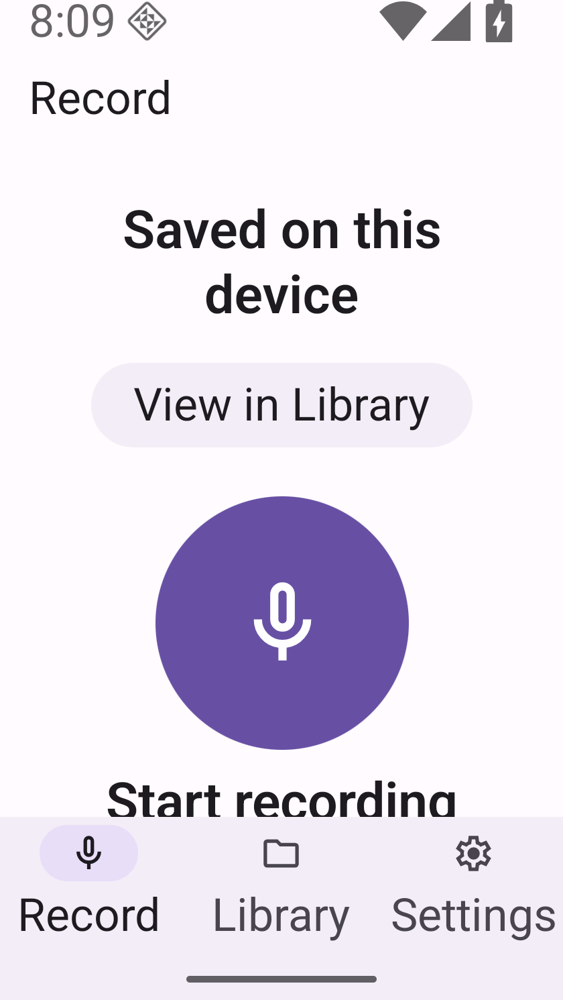
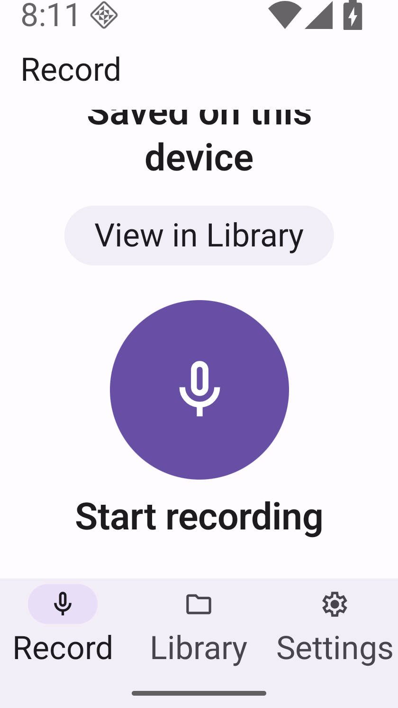
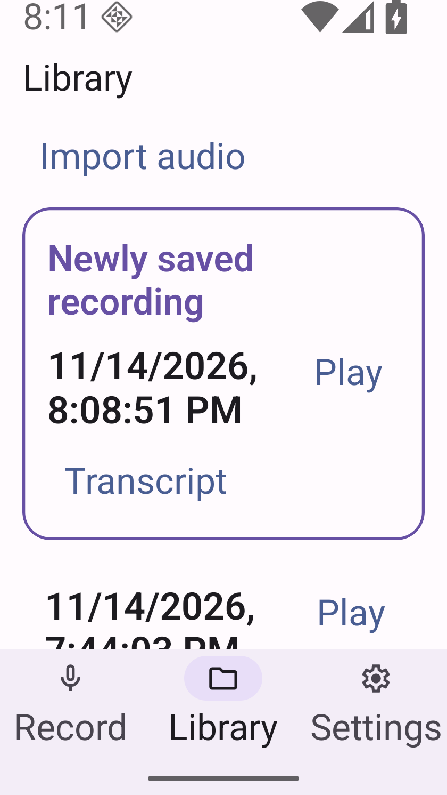

# One production Start: bounded small Saved proof

[Draft PR62](https://github.com/innosage-llc/innosage-labs/pull/62) remains **BLOCKED** pending a new coordinator decision. This separate authorization executes the parent's prior next-step proposal; it does not erase that proposal/history, grant owner acceptance, or extend PR61's risk acceptance. [Issue60](https://github.com/innosage-llc/innosage-labs/issues/60) and broader56/58 remain open.

Budget2026-11-14T12:02:27Z–12:32:27Z, runtime cutoff12:20Z. Exactly **one production Start**, ledger STARTED before input, no retry. No product edit, instrumentation, diagnostic/baseline trial, reinstall, remote CI, provider call, dependency install, lifecycle investigation, merge/deploy or owner request.

## Result and actual UI

Boot foreground was actually Launcher, with no app process observed. Home while idle retained Launcher. Stable configuration was established **before app launch/Start** from idle Launcher:840×1491 at420dpi,320dp width, font2.0. All16 existing displayed identities were enumerated at that stable configuration before Start. After the actual startup permission dialogs, size/font/rotation/a11y/permission settings were not changed during active Recording, and no Home/background trial occurred. Actual microphone one-time grant and notification denial dialogs were sampled, with foreground/Activity/PID/grants snapshots before/after.

Actual production label Start → Recording **0:00→0:03** → fresh observed Stop & save → exact **Saved on this device**. Original TOP and BOTTOM PNG/XML were captured. TOP clips part of the lower Start label; scrolling the actual content reveals the complete circle, native action and label above fixed navigation. TOP-return restores the full Saved feedback. View in Library locates the highlighted new identity **11/14/2026,8:08:51 PM**, with Play and no Pause/playing state observed. No Play input was issued. This supports no autoplay observed, not continuous physical-audio silence.

| Actual production Saved TOP | Actual production Saved BOTTOM | Actual highlighted Library handoff |
| --- | --- | --- |
|  |  |  |

| Actual bottom geometry, px | Bounds |
| --- | --- |
| ScrollView clip | `[0,231][840,1218]` |
| Unified enabled/clickable native action | `[126,611][715,1155]` |
| Complete Start recording label | `[158,1042][683,1134]` |
| Decorative circle, original PNG exact-color pixel extent | `[233,632][610,1010]` |
| Fixed Record/Library/Settings navigation container | `[0,1218][840,1428]` |

Action and label clear navigation by **63px/84px**. Circle is visually contained; its independent native node is unavailable in the merged hierarchy. Pixel extent is decorative visual evidence, **not separate native hit bounds**; source144dp sizing and enclosing native action are distinct evidence. [Sanitized bounds](bounds.json).

**Bounded P2 visual/reachability/bounds/handoff proof is satisfied for this trial**, supported by fresh independent review. **Lower Start activation remains NOT_TESTED**: activating it would consume a second Start, outside authorization. Source has one native TextButton callback for circle+label; prior actual hit/semantics/disabled evidence remains separate. This packet does not re-certify audible TalkBack or physical audio.

## Preserved automation failures

After successful save and bottom capture, the first proof script incorrectly expected a clickable ancestor for the already-selected Record tab. Its assertion, actual Saved phase, foreground and scoped logs were preserved. Read-only inspection then used the actual fixed-navigation container/selected-item structure and completed the same Saved page's bounds/scroll/handoff, with no Start or save retry. The original ledger failure is retained as the proof-script sub-result, distinct from actual successful Start/save.

A pixel-measurement helper found PIL unavailable; nothing was installed. Existing macOS AppKit read the original PNG for circle extent. An earlier automatic approval review declined setup; its retained tool receipt has no execution output or stated reason. The initial model attributed it to the read-only XML ancestry helper, but that attribution is not independently established. Explicit read-only traversal and an input audit demonstrated no Start; the subsequent setup operation was approved and executed. The declined call is not counted as executed, and no authorization boundary was bypassed.

## Source, provenance, review and gates

Frozen production source `9d199559f96aedd019d56ee374de8888460eee4c`; intake docs head `dfe6c21b7d4deaba6d4ea73e79e67ceb5118430d`. All45 tracked non-doc source/config/lock hashes remain equal. Exact installed APK/JS, signer/package/version/schema were verified before configuration; no install was needed.

- APK SHA256 `1d3581f6f19773a5122647c11916d867608fda91672cfd0abfa48640819b5dee`.
- Embedded JS SHA256 `ceb030d7262c0e68a7734201ddd512e9a966b1edc8daa95854d40847685a9a0f`.

[Six original production PNG provenance/hash/size/time/font/dimension entries](manifest.json) and [one-Start/data/settings ledger](ledger.json) accompany this report. Later heads contain only docs/evidence; no new final-head production gates are claimed. Historical39tests/typecheck/offlineRelease/full native lint PASS remain same-source **NOT_RERUN**. Retain LOCALCI; no new remote workflow or remote CI run. Original manual UniversalUI/dependency/overview/inventory/read receipts and sanitized routing ledger remain unchanged; no automatic-dispatch claim is added.

A real fresh read-only Sol6.1 medium CLI reviewer directly viewed TOP, BOTTOM, advancing timer, TOP-return and Library-highlight PNGs, parsed native XML/bounds, and inspected pinned source, ledger, configuration and restoration receipts. It found bounded P2 visual/scroll/bounds/handoff satisfied; lower activation and prior faults remain unresolved. It confirmed the decorative-pixel/native-hit distinction and no-autoplay observation's limits. Original invocation/JSONL/output are private, not a manufactured primary summary. Shutdown was pending at that review's final check; the subsequent actual shutdown receipt is retained and independently followed up before final delivery.

## Data, restoration and remaining risks

Before boot, only the existing owned isolated profile was verified closed/owned, ports free, backing chains contained and host audio disabled. A new independent APFS cold backup containing all16 recording identities and all profile data/key/config files was hash/inode verified inside the controller and never booted. Original/old candidate/other profiles/devices/shared ADB were untouched.

Final displayed set is **all16 old identities +one new production save =17**. This verifies displayed identity preservation, not byte-level integrity/playback of every file. Only after Saved/idle, normal permission UI restored Don't allow→Ask every time and notification On→Off. Font/display/rotation/a11y/touch exploration and permission grants+flags match initial values exactly. TalkBack preferences unchanged; audible speech remains NOT_VERIFIED. Exact production APK/JS readback and final Record idle were verified before graceful owned shutdown; owned ports/profile closure were verified before runtime cutoff. No extra Start or Play occurred during cleanup.

The earlier PR62 generic startup FAILED remains unexplained. The later simultaneous size/font-transition capture-loss FAILED remains a separate unresolved observation. This fixed-configuration success resolves neither, establishes no causal link, fix, matched-baseline result or regression attribution. PR61 original NOT_REPRODUCED/NOT_FIXED and historical six-slot **5 PASS/1 PARTIAL** remain unchanged. Recommendation to coordinator: treat only this bounded P2 evidence gap as filled; preserve separate fault/risk decisions and Draft/BLOCKED until a fresh decision. No owner approval is requested here.

Independent shutdown follow-up resolved the pending finding. Its report wording qualification is applied above: actual startup permission dialogs change grants; settings stayed unchanged during active Recording. The original stop-time field was sampled after the kill response, not an exact request timestamp. A subsequent read-only check explicitly preserved lsof returncode1 plus empty stdout/stderr for owned ports/profile, strengthening closure verification without booting or operating any device.

Publication checkpoint **2026-11-14T12:19:02.667555+00:00, 16.59/30minutes** including setup/runtime/review/reporting so far. [Six immutable remote PNG byte checks and actual independent review receipt hashes](verification.json). Final independent affected-findings check confirms corrected wording/audit qualifications; remaining loweractivation and prior faults stay open.
